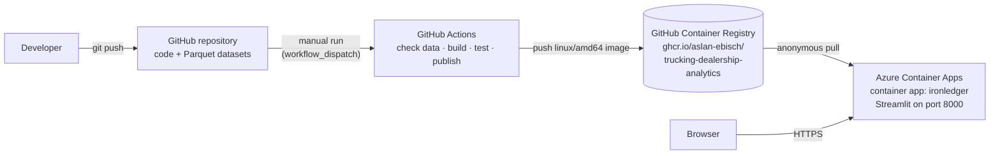
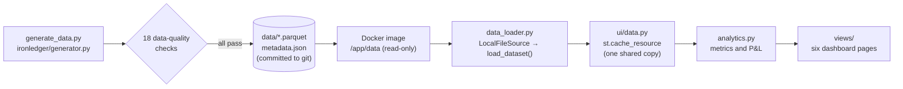

# IRONLEDGER Analytics

**Commercial Truck Dealership Intelligence** — *Intelligence that drives the business.*

[](https://github.com/aslan-ebisch/trucking-dealership-analytics/actions/workflows/publish-image.yml)

### 🔗 Live application: <https://ironledger.ambitioustree-2f4259ca.westus2.azurecontainerapps.io>

Hosted on **Azure Container Apps**. The app scales to zero when nobody is using it, so the first visit after a quiet
period takes longer while a replica starts and loads the data.

IronLedger is a business-intelligence dashboard for a fictional, ten-store commercial truck dealership group. It turns
roughly 30,000 sales transactions, a 31,000-unit inventory ledger, and nearly six years of operating expenses into
six interactive pages covering sales performance, inventory aging, profitability, and customer behavior.

It was built for a university **Big Data & Cloud Computing** course with Python, Streamlit, pandas and Plotly. It is
packaged as a Docker image that **GitHub Actions** builds and publishes to **GitHub Container Registry**, and
**Azure Container Apps** runs that image.

> **All data is synthetic.** Every dealership, employee, customer, and transaction is fictional and generated by
> `generate_data.py`. Manufacturer and model names (Peterbilt, Kenworth, Freightliner, Volvo, Mack, Western Star,
> Utility, Great Dane, Wabash, Fontaine) appear only as ordinary product descriptors. This project is not affiliated
> with, endorsed by, or based on records from any manufacturer or dealership.

---

## Contents

1. [Project overview](#1-project-overview)
2. [Features and dashboard pages](#2-features-and-dashboard-pages)
3. [Technology stack](#3-technology-stack)
4. [Architecture](#4-architecture)
5. [Repository structure](#5-repository-structure)
6. [Running locally](#6-running-locally)
7. [Synthetic data generation](#7-synthetic-data-generation)
8. [Datasets](#8-datasets)
9. [Financial metric definitions](#9-financial-metric-definitions)
10. [Testing](#10-testing)
11. [Docker image](#11-docker-image)
12. [GitHub Actions build and publish](#12-github-actions-build-and-publish)
13. [Azure Container Apps deployment](#13-azure-container-apps-deployment)
14. [Earlier infrastructure work: Terraform for App Service](#14-earlier-infrastructure-work-terraform-for-app-service)
15. [Future improvements](#15-future-improvements)

---

## 1. Project overview

| | |
|---|---|
| **Fictional business** | Red River Commercial Truck Group: 10 stores across TX, OK, MO, AR, CO and TN |
| **History** | January 1, 2021 → October 31, 2026 (data "as of" Oct 31, 2026) |
| **Data volume** | 30,000 sales · 31,191-unit inventory ledger · 5,000 customer accounts · 100 salespeople · 659 store-month expense records |
| **Scales to** | 100,000+ sales with no code changes (`python generate_data.py --sales 100000 --customers 12000 --salespeople 300 --force`) |
| **Pages** | Executive Overview · Sales Performance · Inventory Management · Financial Analytics · Customer Intelligence · Data Explorer |
| **Hosting** | Azure Container Apps (Consumption plan), image from GitHub Container Registry |

### The business problem

A multi-store truck dealer runs on thin front-end margins (typically 5–10%), expensive inventory financed through
floorplan credit lines, and a customer base where a few fleets drive a large share of revenue. Management needs
answers to questions like these:

- Which stores, brands, and salespeople generate gross profit, and not just revenue?
- How much capital is tied up in aging inventory, and what does it cost each month to carry?
- How did the freight-market cycle affect used-truck margins?
- How dependent are we on our largest fleet accounts?
- After paying for people, facilities, and floorplan interest, what does the sales department actually earn?

IronLedger answers these from one consistent set of transaction-level records.

## 2. Features and dashboard pages

| Page | What it shows |
|---|---|
| **Executive Overview** | Eight KPI cards with sparklines and period-over-period deltas. Comparisons can be year-over-year or against the prior period, with an optional **same-store** basis that excludes stores opened mid-history. Also shows monthly revenue and gross profit against the prior year, revenue by store and brand, unit mix, and auto-generated highlights. |
| **Sales Performance** | A sortable salesperson leaderboard (revenue, units, gross, gross per unit) with a minimum-volume threshold, a side-by-side rep comparison, a network map, a volume-vs-profitability bubble chart, store trend comparisons, manufacturer share over time, and a store × category heatmap. |
| **Inventory Management** | Units, cost basis, age, months' supply, and estimated floorplan carrying cost. Aging buckets (0–30 / 31–60 / 61–90 / 91–120 / 120+ days) by store, a month-end on-hand history *reconstructed from the unit ledger*, a searchable unit table with CSV export, and an aged-unit watchlist. |
| **Financial Analytics** | A sales-department P&L from revenue to estimated operating income, a gross-to-operating-income waterfall, monthly operating income, new-vs-used gross per unit through the market cycle, profitability by manufacturer, store and category, and the operating-expense structure. |
| **Customer Intelligence** | Segment economics, repeat-purchase rates, a Lorenz curve with top-10 share and HHI concentration, a revenue map by customer home state, top accounts, and per-account purchase history. |
| **Data Explorer** | Browse any dataset with full-text search, per-column filters, sorting, and CSV export. Includes a schema and missing-value profile, descriptive statistics, a **live data-quality panel** (18 automated checks), an entity-relationship diagram, and generation metadata. |

**Global filters.** Reporting period, dealership, manufacturer, condition, and vehicle category apply to every page.
Each page shows a banner stating which slice of the data is displayed and how many records are in scope. When a
filter matches nothing, the page shows an explanatory empty state instead of an error.

## 3. Technology stack

| Layer | Technology |
|---|---|
| Language | Python 3.11 (container and Azure); also tested locally on Python 3.13 |
| Web UI | Streamlit 1.67 (native multipage navigation, `st.metric` sparklines, custom dark theme) |
| Charts | Plotly 7.1 (custom "ironledger" template, colorblind-checked palette) |
| Data processing | pandas 2.3, NumPy 2.4 (fully vectorized data generator) |
| Storage format | Apache Parquet via PyArrow 26 (optional CSV mirrors for spreadsheet users) |
| Testing | pytest + Streamlit `AppTest` (headless UI tests) |
| Containerization | Docker, `python:3.11-slim-bookworm` base image |
| CI build | GitHub Actions |
| Image registry | GitHub Container Registry (GHCR), public package |
| Hosting | Azure Container Apps, Consumption plan |
| Provisioning | Azure CLI (live deployment); Terraform (earlier App Service work, see section 14) |

All runtime dependencies are pinned in `requirements.txt`. No database server is required.

## 4. Architecture

### 4.1 Deployment architecture



1. **GitHub** holds the code and the six Parquet datasets the app reads.
2. **GitHub Actions** checks the datasets, builds the Docker image for `linux/amd64`, tests it, and pushes it to
   GHCR only if every check passes (section 12).
3. **GitHub Container Registry** stores the image. The package is public, so Azure pulls it without credentials.
4. **Azure Container Apps** runs the image. Its HTTPS ingress forwards traffic, including the WebSocket connection
   Streamlit relies on, to the container on **port 8000** (section 13).

The Azure resources were created with the **Azure CLI**. The Terraform files in `infra/terraform/` come from earlier
App Service work and do not manage this deployment (section 14).

### 4.2 Data architecture



- **Generate once, read many times.** The generator writes the datasets offline and validates them first. If any
  of the 18 checks fails, nothing is written. The running app never generates or writes data.
- **Parquet as the storage format.** Columnar, compressed and typed: the six tables take about 3.5 MB as Parquet,
  compared with about 13 MB as CSV, and load with their types intact.
- **Data travels with the image.** The Parquet files are committed to git and copied into the Docker image, so every
  image is self-contained and read-only at runtime.
- **One data-access layer.** Only `ironledger/data_loader.py` touches files. It defines a small `DataSource`
  interface (`read_table`, `read_metadata`, `signature`) with one implementation today, `LocalFileSource`. A cloud
  backend such as Azure Blob Storage would be a new class selected with `IRONLEDGER_DATA_SOURCE`, with no changes
  to analytics or page code.
- **Load once per container.** `load_dataset()` applies types (dates, categoricals) and adds reporting columns.
  `st.cache_resource` keeps **one shared, read-only copy** in memory for all users and reruns. The cache key is a
  signature of file names, sizes and modification times, so changed data invalidates the cache automatically.
- **Layered code.** Dependencies point one way: `views → ui → analytics → data_loader`. The analytics layer never
  imports Streamlit, so every number can be unit-tested and reused outside the dashboard.

Measured memory use on Python 3.11 is about 130 MB after imports, about 220 MB after the dataset loads, and about
400 MB at peak after every page has rendered. That fits comfortably in the container's 1 GiB.

## 5. Repository structure

```text
trucking-dealership-analytics/
├── app.py                      # Entry point: theme, sidebar filters, navigation
├── generate_data.py            # CLI: generate → validate → write datasets
├── requirements.txt            # Runtime dependencies (pinned)
├── requirements-dev.txt        # + pytest
├── pytest.ini
├── Dockerfile                  # Production image: Python 3.11, Streamlit on port 8000
├── .dockerignore               # Keeps secrets, Terraform, tests and CSVs out of the image
├── .github/workflows/
│   └── publish-image.yml       # Manual workflow: check data, build, test, publish to GHCR
├── .streamlit/config.toml      # Dark theme, fonts, chart palette
├── assets/                     # IronLedger logo and icon (SVG)
├── ironledger/                 # Application package
│   ├── config.py               # Paths, reporting window, environment-variable settings
│   ├── reference_data.py       # Business assumptions: stores, catalog, market cycle
│   ├── generator.py            # Synthetic data engine
│   ├── validation.py           # 18 data-quality checks (shared by CLI, tests and UI)
│   ├── data_loader.py          # Data-access layer (swap point for cloud storage)
│   ├── analytics.py            # All business and financial calculations (no UI code)
│   └── ui/                     # Streamlit-only helpers
│       ├── theme.py            # Colors, Plotly template, CSS
│       ├── charts.py           # Reusable figures
│       ├── components.py       # KPI cards, headers, context banner, formatting
│       ├── filters.py          # Global sidebar filters
│       ├── data.py             # Cached dataset loading
│       └── page.py             # Common page setup
├── views/                      # One file per dashboard page (six pages)
├── tests/
│   ├── test_analytics.py       # Metric math checked against hand-computed answers
│   ├── test_data_quality.py    # Integrity, determinism, corruption detection
│   └── test_app.py             # Every page renders; filters change results
├── data/                       # Parquet datasets + metadata.json (committed); CSV mirrors git-ignored
└── infra/terraform/            # Earlier App Service infrastructure (not used by the live app)
```

## 6. Running locally

Requires Python 3.11 or newer. The datasets are already in `data/`, so there is nothing to generate before the
first run.

```bash
git clone https://github.com/aslan-ebisch/trucking-dealership-analytics.git
cd trucking-dealership-analytics
python3 -m venv .venv
source .venv/bin/activate              # Windows: .venv\Scripts\activate
python -m pip install --upgrade pip
python -m pip install -r requirements-dev.txt   # runtime dependencies + pytest

python -m streamlit run app.py         # opens http://localhost:8501
```

If the datasets are missing, the app shows a setup screen with the command that regenerates them.

To run the same container that Azure runs instead, see section 11.

> **Tips for macOS and iCloud Drive.**
> - Python refuses to create a virtual environment in a path that contains a colon (`:`), because the colon is the
>   `PATH` separator. Rename the folder, or create the environment elsewhere, for example `python3 -m venv ~/.venvs/ironledger`.
> - If the project lives in **iCloud Drive**, a virtual environment outside the project folder keeps iCloud from
>   syncing thousands of library files.

## 7. Synthetic data generation

The committed datasets can be regenerated from the same seed (only the timestamp in `metadata.json` changes):

```bash
python generate_data.py --force        # ~2 seconds: 30k sales, Parquet + CSV, validated
```

- The generator **validates before writing**. If any of the 18 data-quality checks fails, nothing is written.
- It **never silently overwrites** an existing dataset. Without `--force` it prints a notice and exits.
- It is **deterministic**: the same `--seed` always produces identical data.

| Option | Default | Purpose |
|---|---|---|
| `--sales` | 30000 | number of sales transactions |
| `--customers` | 5000 | commercial customer accounts (including prospects) |
| `--salespeople` | 100 | roster size, including former reps |
| `--seed` | 20260131 | random seed |
| `--format` | both | `parquet`, `csv`, or `both` |
| `--out` | `data/` | output folder |
| `--force` | off | allow overwriting an existing dataset |

### Why 30,000 sales and not 50,000? (realism decisions)

The initial brief suggested 50,000 sales, 10,000 inventory records and 2,000 customers. Those numbers were checked
against how commercial truck dealerships actually operate and adjusted where they would have been implausible:

| Brief | Implemented | Reasoning |
|---|---|---|
| 50,000 sales | **30,000** | 50,000 sales across 10 stores in under six years is ~860 units per store per year (~7 per salesperson per month), roughly 3× a typical truck-dealer location. 30,000 gives Dallas ~1,000 units a year, small stores ~250, and ~4–5 units per rep per month, which is believable. Use `--sales 100000` for scale testing. |
| 10,000 inventory records | **~31,000-unit ledger, ~1,200 in stock** | 10,000 trucks *on the lot* would be about two years of supply. Instead, `inventory` is the master record of every unit ever acquired: ~30,000 sold plus ~1,200 currently in stock (about two months' supply, consistent with the history). |
| 2,000 customers | **5,000 accounts** | With 2,000 customers, even owner-operators averaged 6+ trucks each and 93% of buyers were repeat customers. With 5,000 (including ~1,100 prospects who never bought), owner-operators average ~2 purchases while national fleets average ~100. |
| Stores open throughout | **Denver opens Apr 2022, Nashville Mar 2023** | Dealer groups grow by acquisition. This creates real "new store" growth and is why the same-store comparison exists. |

### How the data stays realistic and internally consistent

- **Unit master first.** Every truck or trailer has exactly one inventory row. A sale references its `unit_id`, and
  inventory status, dates and costs must match the sale (validated).
- **Causal pricing.** Selling price = catalog base price × spec variation × market-cycle price index × age
  depreciation × mileage adjustment × local pricing. Used-unit **acquisition cost is set from market value on the
  acquisition date**, so when used values fall while a unit sits on the lot, the dealer can lose money. This is why
  2023 used-truck margins collapse in the data.
- **Stylized market cycle** (not actual industry data): a 2021–22 freight boom with constrained new-truck supply, a
  2023–24 freight recession, and a 2025–26 recovery with pre-buying. Monthly seasonality includes a December
  year-end buying spike.
- **Exact accounting.** Money is stored as whole dollars. Gross profit is computed by subtraction, so identities hold
  to the dollar.
- **People and time.** Each sale is credited to a rep employed at that store on that date (the roster includes
  turnover). Customers buy mostly at their home store, and their segment drives what they buy, how they pay, and
  which sales channel they use.
- **Expenses tied to activity.** Monthly payroll includes the commissions actually earned on that month's deals, and
  floorplan interest is charged on the inventory actually on hand mid-month.

## 8. Datasets

| File (`data/`) | Rows | Grain | Key columns |
|---|---:|---|---|
| `sales` | 30,000 | one row per vehicle sale | `sale_id`, `sale_date`, `dealership_id`, `salesperson_id`, `customer_id`, `customer_segment`, `unit_id`, `manufacturer`, `model`, `model_year`, `vehicle_category`, `condition`, `mileage`, `inventory_acquisition_date`, `days_in_inventory`, `acquisition_cost`, `reconditioning_cost`, `transportation_cost`, `sale_price`, `vehicle_gross_profit`, `vehicle_gross_margin`, `financing_arranged`, `finance_income`, `protection_product`, `warranty_income`, `total_gross_contribution`, `sales_commission`, `sale_channel`, `transaction_status` |
| `inventory` | 31,191 | one row per physical unit ever acquired | `unit_id`, `dealership_id`, vehicle attributes, `acquisition_source`, `acquisition_date`, costs, `total_cost_basis`, `list_price` (in-stock only), `status` (`Sold` / `In Stock`), `sale_id`, `sale_date`, `days_in_inventory` |
| `customers` | 5,000 | one row per account | `customer_id`, `customer_name`, `customer_segment`, `home_state`, `primary_dealership_id`, `fleet_size`, `credit_tier`, `customer_since`, `account_status` |
| `salespeople` | 100 | one row per rep (current and former) | `salesperson_id`, `salesperson_name`, `dealership_id`, `role`, `hire_date`, `termination_date`, `employment_status` |
| `dealerships` | 10 | one row per store | `dealership_id`, name, city, state, region, coordinates, `opened_date`, franchises, `lot_capacity` |
| `operating_expenses` | 659 | store × month | `payroll_expense`, `facility_expense`, `marketing_expense`, `utilities_expense`, `floorplan_interest_expense`, `other_operating_expense`, `total_operating_expense`, `avg_floorplan_balance`, `floorplan_rate` |
| `metadata.json` | — | — | seed, parameters, row counts, generation timestamp |

The six Parquet files and `metadata.json` are **committed to the repository** because the Docker image is built from
the repository. If you regenerate the data, commit the new Parquet files and run the workflow again. CSV mirrors are
optional and git-ignored.

Some blank values are **expected**: trailers have no `mileage` (no odometer), sold units have no `list_price`, and
deals without a protection product have no `protection_product`. The Data Explorer profile explains each one.

## 9. Financial metric definitions

| Metric | Definition |
|---|---|
| Vehicle sales revenue | Σ selling price. **F&I income is not revenue** and is never added to it. |
| Cost of vehicles sold | Σ (acquisition + reconditioning/make-ready + inbound transportation) |
| Vehicle gross profit | Revenue − cost of vehicles sold (front-end gross) |
| Vehicle gross margin | Vehicle gross profit ÷ revenue |
| F&I income | Finance reserve income + protection-product income (back-end gross) |
| Total gross contribution | Vehicle gross profit + F&I income |
| Operating expenses | Sales-department payroll (including commissions) + facility + marketing + utilities + floorplan interest + other |
| Est. operating income | Total gross contribution − operating expenses |
| Average selling price | Revenue ÷ units |
| Gross per unit (GPU) | Vehicle gross profit ÷ units |
| Days to sell | Mean (sale date − acquisition date) |
| Months' supply | Units in stock ÷ average monthly units sold over the last 90 days |
| Growth | (current − prior) ÷ \|prior\|. Margins and rates change in **percentage points**. |

Accounting guardrails built into the app:

- **Gross profit is not net profit.** "Est. operating income" covers the *sales department* only and excludes
  service and parts, corporate overhead, depreciation, and income tax.
- Expenses are recorded per **store**. When a manufacturer, condition, or category filter is active, the P&L stops at
  total gross contribution instead of inventing an expense allocation.
- When a period covers part of a month, its expenses are **prorated by day**, so expenses always cover the same
  days as the matching sales.
- Growth is shown as *n/a* when the comparison period predates recorded history. Windows extending past the as-of
  date are clipped, so incomplete periods are never compared with complete ones. Partial months are faded in charts,
  and incomplete quarters are excluded from total-based quarterly trends.

## 10. Testing

```bash
python -m pytest -q
```

68 tests (about 15 seconds) cover:

- **Analytics math.** Revenue, gross, margin, ASP, GPU, F&I separation, safe division, period-over-period logic
  (YoY, sequential, clipping, unavailable history, same-store), filters, expense proration, partial-period
  handling, aging-bucket boundaries, inventory reconstruction, concentration metrics, leaderboard sorting, and P&L
  reconciliation, all checked against hand-computed answers.
- **Data quality.** All 18 checks on freshly generated data and after Parquet/CSV round-trips: unique IDs, valid
  foreign keys, reps employed on the sale date, sale dates after acquisition, plausible prices and mileage, exact
  financial identities, and inventory/sales reconciliation. Also tests determinism, and that the checks *catch*
  deliberately corrupted data.
- **UI.** Every page renders headlessly without exceptions, every page handles an empty filter result, filters
  change the KPIs, and a missing dataset shows the setup screen.

## 11. Docker image

The `Dockerfile` produces the self-contained image that runs in Azure.

| | |
|---|---|
| Base | `python:3.11-slim-bookworm` (all pinned packages install from prebuilt wheels) |
| Dependencies | `requirements.txt`, pinned |
| Application | `app.py`, `ironledger/`, `views/`, `assets/`, `.streamlit/config.toml` |
| Data | The six Parquet datasets and `metadata.json`, at `/app/data` |
| Server | `streamlit run app.py` on `0.0.0.0:8000`, headless, file watcher off, usage statistics off |
| User | Non-root `ironledger` (UID 10001); `/app` is owned by root and not writable |
| Health | `GET /_stcore/health` returns `ok` (used by the Docker `HEALTHCHECK`) |

Safeguards built into the image:

- The Dockerfile copies an explicit list of files instead of the whole folder, and names each dataset individually,
  so **the build fails if a dataset is missing**.
- During the build, a step loads every table with `load_dataset()` and compares row counts with `metadata.json`.
  Missing or corrupt data stops the build instead of reaching users.
- `.dockerignore` keeps tests, the data generator, CSV mirrors, `infra/` (including Terraform state) and
  `.streamlit/secrets.toml` out of the image.
- The app never writes to disk (CSV exports are built in memory), so the container runs with a read-only filesystem.

**Build and run locally** (requires Docker; on Apple Silicon, `--platform linux/amd64` matches what Azure runs):

```bash
docker build --platform linux/amd64 -t ironledger-analytics:local .
docker run --rm -p 8000:8000 ironledger-analytics:local        # open http://localhost:8000

# Or run the published image
docker run --rm -p 8000:8000 ghcr.io/aslan-ebisch/trucking-dealership-analytics:latest

# Health check from another terminal
curl -s http://localhost:8000/_stcore/health                   # -> ok
```

## 12. GitHub Actions build and publish

The workflow [`.github/workflows/publish-image.yml`](.github/workflows/publish-image.yml) builds the image on a
GitHub-hosted runner, so building it needs no local Docker installation. It runs only when started manually.

1. **Check the datasets in the repository.** All six `data/*.parquet` files must exist and be real Parquet files (not
   Git LFS pointers), and `data/metadata.json` must list row counts for exactly those six tables.
2. **Build the image** for `linux/amd64`. The Dockerfile's own validation step runs as part of the build.
3. **Test the image before publishing.** The workflow confirms all seven data files are in the image and `/app` is
   not writable. It then starts the container with a read-only filesystem and no Linux capabilities, waits for
   `/_stcore/health` to return `ok`, and checks that the main page returns HTTP 200.
4. **Publish to GHCR** only if every step passed, then write the tags, image digest and package link to the run's
   summary page.

**Security.** The workflow authenticates with the repository's built-in `GITHUB_TOKEN`; no personal access token is
stored. All permissions are denied by default, and the job receives only `contents: read` and `packages: write`.
Every third-party action is pinned to a full commit SHA.

**Run it**

- *Web:* **Actions** tab → **Publish container image** → **Run workflow** → branch `main`.
- *CLI:*
  ```bash
  gh workflow run publish-image.yml --ref main
  gh run watch
  ```

**Published image**

| | |
|---|---|
| Image | `ghcr.io/aslan-ebisch/trucking-dealership-analytics` |
| Tags | `sha-<7-character commit>` on every run; `latest` on runs from `main`; the branch name on runs from other branches |
| Package page | <https://github.com/aslan-ebisch/trucking-dealership-analytics/pkgs/container/trucking-dealership-analytics> |
| Visibility | Public, so anyone (including Azure) can pull it without logging in |

To confirm the package is publicly pullable without Docker or a login:

```bash
curl -s -o /dev/null -w '%{http_code}\n' \
  "https://ghcr.io/token?scope=repository:aslan-ebisch/trucking-dealership-analytics:pull"
# 200 = public   403 = private or not published
```

## 13. Azure Container Apps deployment

The live application runs on **Azure Container Apps** on the Consumption plan. The resources were created with the
**Azure CLI**. They are not managed by the Terraform in this repository.

| Setting | Value |
|---|---|
| URL | <https://ironledger.ambitioustree-2f4259ca.westus2.azurecontainerapps.io> |
| Container app | `ironledger` |
| Container Apps environment | `ironledger-env` (Consumption workload profile) |
| Resource group / region | `rg-ironledger-containerapps` / West US 2 |
| Image | `ghcr.io/aslan-ebisch/trucking-dealership-analytics:latest`, pulled anonymously from the public GHCR package (no registry credentials stored in Azure) |
| Ingress | External, HTTPS, target port **8000**, HTTP transport |
| Resources per replica | 0.5 vCPU, 1 GiB memory |
| Scaling | 0 to 1 replicas: scales to zero when idle, never more than one replica |

Why these settings:

- **Port 8000** matches the port Streamlit listens on inside the image.
- **One replica at most.** Each Streamlit session lives in the memory of one replica. With a single replica, a
  user's WebSocket session never lands on a different replica.
- **Scale to zero** keeps costs near zero when nobody is using the app. The trade-off is a slower first visit.
- **0.5 vCPU / 1 GiB** fits the app's measured peak of about 400 MB.

To inspect the live configuration (read-only):

```bash
az containerapp show --name ironledger --resource-group rg-ironledger-containerapps \
  --query "{url:properties.configuration.ingress.fqdn, image:properties.template.containers[0].image, port:properties.configuration.ingress.targetPort}"
curl -s https://ironledger.ambitioustree-2f4259ca.westus2.azurecontainerapps.io/_stcore/health   # -> ok
```

To roll out a newly published image, point the app at the image's `sha-…` tag, which creates a new revision:

```bash
az containerapp update --name ironledger --resource-group rg-ironledger-containerapps \
  --image ghcr.io/aslan-ebisch/trucking-dealership-analytics:sha-<commit>
```

## 14. Earlier infrastructure work: Terraform for App Service

Before the container approach, the project targeted **Azure App Service**. `infra/terraform/` from that phase defines:

- a resource group (`rg-ironledger-dev`, Central US by default),
- a Linux App Service plan on the free **F1** tier, and
- a Python 3.11 web app that installs `requirements.txt` during deployment and starts Streamlit on port 8000 with
  WebSockets enabled.

**This Terraform does not describe or manage the live application.** The Container Apps environment and the
container app in section 13 were created separately with the Azure CLI and are not in Terraform state. Terraform's
state records only the `rg-ironledger-dev` resource group, and that group contains no resources. The App Service plan
and web app in these files were never created.

The files are kept as a record of the project's infrastructure-as-code work and as a starting point for future
Terraform (section 15).

## 15. Future improvements

1. **Infrastructure as code for the live deployment.** Describe the Container Apps environment and container app in
   Terraform (or Bicep) so the live setup can be recreated from the repository.
2. **Deploy by immutable tag.** Point the container app at a `sha-…` tag or image digest instead of `latest`, so the
   running version is always explicit.
3. **Automated deployment.** Add a workflow step that updates the container app after a successful build, using
   Azure workload identity federation instead of stored credentials.
4. **Health probes.** Add Container Apps liveness and readiness probes on `GET /_stcore/health`.
5. **Cloud storage.** Move the Parquet files to **Azure Blob Storage / Data Lake Storage Gen2** and add an
   `AzureBlobSource` implementing the existing `DataSource` interface, selected with
   `IRONLEDGER_DATA_SOURCE=azure_blob`. Data could then be refreshed without rebuilding the image.
6. **Data pipeline.** Run `generate_data.py` (or a real data feed) as a scheduled job, such as an Azure Function or
   a Container Apps job, that writes new Parquet partitions.
7. **Scale-out.** For much larger volumes, query Parquet in place with **Azure Synapse serverless SQL**, or move the
   fact tables to **Azure SQL Database** behind an `AzureSqlSource`.

---

*IronLedger Analytics is an educational project. All business data is synthetic and for demonstration only.*
